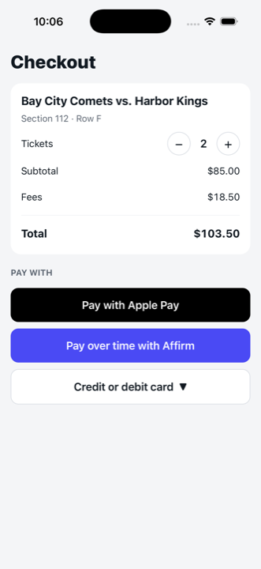
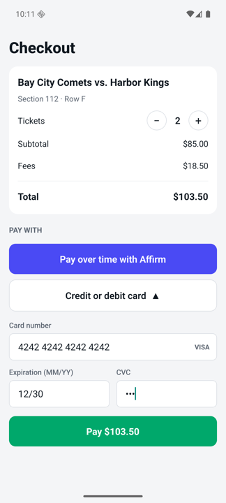
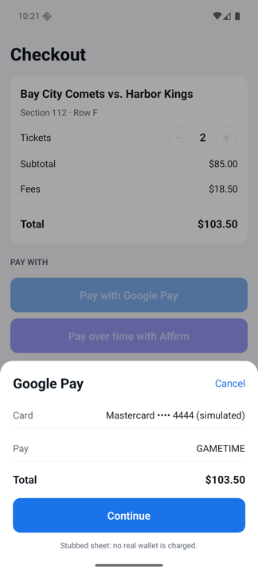
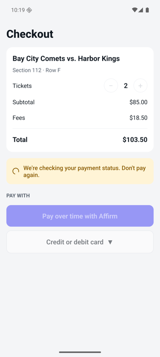
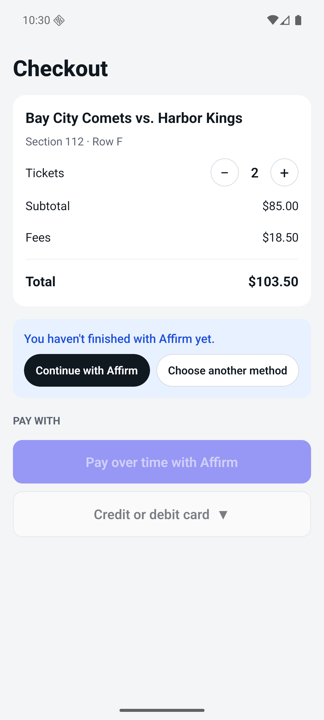
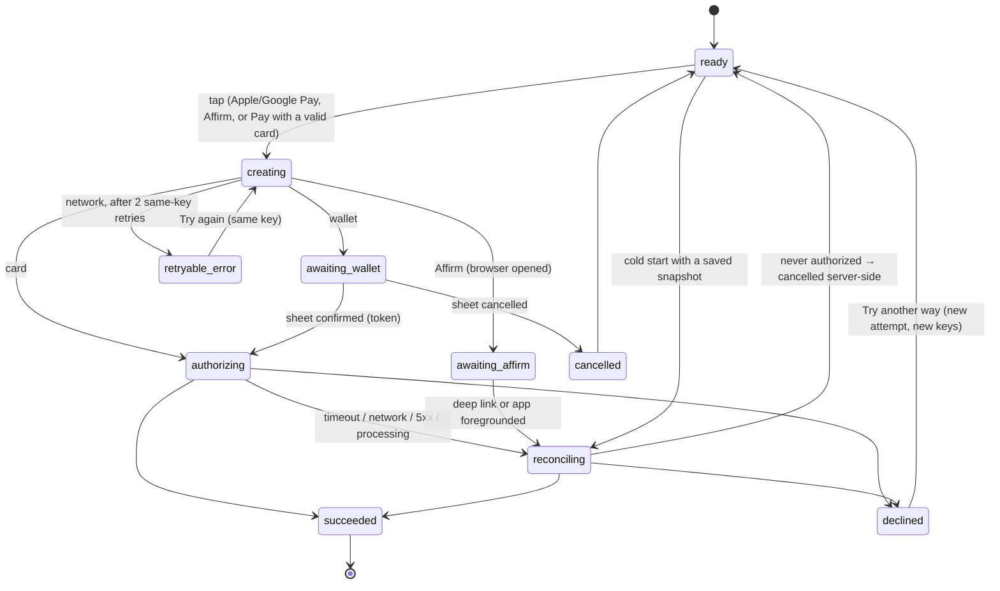

# Gametime Checkout — mobile take-home

A React Native (bare, TypeScript) checkout screen for iOS and Android, plus a local mock payment
server (Node, Express, SQLite). It shows Apple Pay, Google Pay, Affirm and card only when their
rules are met, validates cards properly, completes express payments in one interaction, and
survives backgrounding, OS interruptions and kill/relaunch mid-payment without charging twice.

| iOS — real detection | Card form | Simulated Google Pay sheet | Relaunch after a kill | Affirm not finished |
|---|---|---|---|---|
|  |  |  |  |  |

---

## 1. What I built

- **Checkout screen**: order summary with a 1–4 ticket stepper ($51.75 per ticket incl. fees, so
  1 ticket is under the Affirm threshold and 2 tickets are over it), payment methods, a status area
  for every payment state, and a success screen.
- **Eligibility** with real wallet detection by default (native module, §3), recomputed on every
  quote change.
- **Card form** with formatting, brand detection, Luhn, expiry-in-the-future, CVC per brand, native
  keyboard/autofill props, and a Pay button that stays disabled until the card is valid.
- **Express flows**: one tap on Apple Pay / Google Pay opens a stubbed native-like sheet; confirming
  it finishes the purchase. One tap on Affirm opens its (mock) checkout in the system browser; the
  result comes back through a `gametime-demo://` deep link and is confirmed with the server.
- **Mock payment API** with idempotent create/authorize, server-side guarantees against double
  payment, and mock-only routes to simulate declines, slow or lost responses.
- **Lifecycle resilience**: an attempt snapshot persisted *before* every request, and a single
  reconciliation path triggered by cold start, `AppState` → `active` and deep links.
- **Hidden environment simulator** (dev builds only) to force iOS/Android and wallet availability.

### Platforms tested

| | Version |
|---|---|
| iOS Simulator | iPhone 17 Pro, iOS 26.5 (Xcode 26.6) |
| Android Emulator | Pixel, API 36, `google_apis` image (no Play Store) |
| React Native | 0.88.0 (bare, New Architecture, Hermes) |
| Node | 24.17 (server and tooling) |
| JDK | 17 |

The app builds and runs on both. Payment flows and the interruption scenarios (§6) were driven on
the Android emulator with `adb`. On the iOS simulator I checked the checkout, eligibility and a full card
payment (keyboard, validation, Pay → confirmed, one authorize on the server). The iOS interruption
paths are covered by the automated orchestrator tests, not by manual runs.

---

## 2. How to run

Prerequisites: Node ≥ 20, Xcode + CocoaPods (iOS), Android Studio with an emulator and JDK 17
(Android).

```bash
# 1. Mock server on :4000 (MOCK_MODE=1, SQLite file at server/data/dev.db)
cd server && npm install && npm run dev

# 2. App dependencies (once)
cd app && npm install
cd ios && bundle install && bundle exec pod install && cd ..

# 3. Run (Metro starts automatically; or run `npm start` in another terminal)
npm run ios        # iOS Simulator — talks to http://localhost:4000
npm run android    # Android Emulator — talks to http://10.0.2.2:4000
```

Tests and type checks:

```bash
cd server && npm test            # 42 Vitest + Supertest tests
cd app && npm test               # 192 Jest tests
cd app && npx tsc --noEmit
```

> If Android ever shows the wallet module as missing after changing `codegenConfig`, delete
> `app/android/app/.cxx` once and rebuild (stale CMake cache, see `docs/DECISIONS.md`).

Test cards (fake): `4242 4242 4242 4242` (approves), `4000 0000 0000 0002` (always declined),
`5555 5555 5555 4444`, `3782 822463 10005` (Amex, 4-digit CVC), `6011 1111 1111 1117`. Any future
expiry (e.g. `12/30`).

---

## 3. Eligibility detection

| Method | Rule | How it is detected |
|---|---|---|
| Apple Pay | iOS **and** a card provisioned in Wallet | `PKPaymentAuthorizationController.canMakePayments(usingNetworks: [.visa, .masterCard, .amex, .discover], capabilities: .threeDSecure)`. The argument-less `canMakePayments()` is not used: it does not prove a card is provisioned. |
| Google Pay | Android **and** Google Pay set up | `PaymentsClient.isReadyToPay` (`play-services-wallet`, `ENVIRONMENT_TEST`) with `CARD`, `PAN_ONLY`/`CRYPTOGRAM_3DS`, Amex/Discover/Mastercard/Visa and `existingPaymentMethodRequired: true`. |
| Affirm | Total **strictly greater** than $100.00 | Pure function on the server-quoted total (`total.minorUnits > 10000`, integer cents). Exactly $100.00 does not show Affirm. The server enforces the same rule (`422 METHOD_NOT_ELIGIBLE`). |
| Card | Always | — |

- The two capability checks live in a small **Turbo Module** (`WalletCapability`, Swift +
  Objective-C++ glue on iOS, Kotlin on Android) behind a JS wrapper. Any error, throw or 3-second
  timeout resolves to `false`: that only hides the wallet, it never blocks checkout.
- Detection runs on launch and again every time the app returns to the foreground, so a card the
  fan just added to (or removed from) Wallet shows up without restarting the app.
- `eligibleMethods({ platform, applePayAvailable, googlePayReady, total })` is a pure function
  (`app/src/domain/eligibility.ts`), tested with the full matrix including 9999 / 10000 / 10001.
- **Total changes:** eligibility is recomputed from every new quote. Changing the quantity bumps the
  order version on the server; Affirm appears/disappears immediately. While an attempt is in flight
  the stepper is locked, except when an Affirm attempt is waiting for the fan (then the server
  cancels that never-authorized attempt when the total changes).
- **Observed values:** iOS Simulator → Apple Pay `true` (it ships with test cards). Android emulator
  (`google_apis`, no card in Google Wallet) → Google Pay `false`; with
  `existingPaymentMethodRequired: false` the same emulator returns `true`, i.e. the API works and
  the device simply has no card. Use the simulator below to see the Google Pay flow.

### Environment simulator

Long-press the **"Checkout"** title (dev builds only, `__DEV__`). Real detection is the default.

| Control | Options |
|---|---|
| Platform | Device · iOS · Android |
| Apple Pay | Real · Card provisioned · No cards |
| Google Pay | Real · Set up · Not set up |
| Slow server (8 s) | Gives time to background or kill the app mid-payment |
| Reset demo | Clears the server (attempts, authorizations, keys) and the app's attempt snapshot |

The menu also shows the real detection result for the device. Forcing "iOS" on Android shows the
(pure JS) Apple Pay sheet, which is fine for reviewing the logic.

Other failure paths need no menu: the `4000 0000 0000 0002` card is always declined, and every sheet
has a Cancel button. The server keeps extra mock routes (forced decline, `processing`, dropped
response, exact totals) for automated tests and `curl`.

---

## 4. Mock API contract

Base URL `http://localhost:4000` (iOS) / `http://10.0.2.2:4000` (Android), configured only in
`app/src/api/config.ts`. Types shared by app and server live in `shared/index.ts`.

| Route | Purpose |
|---|---|
| `GET /v1/orders/:id` | Current quote: line items, `total` in integer cents, `version`, `status` (`open`/`paid`) |
| `PUT /v1/orders/:id` `{ quantity }` | Changes quantity, bumps `version`, cancels `awaiting_user` attempts |
| `POST /v1/payment-attempts` | Creates an attempt for `{ clientAttemptId, order: { id, version }, amount, method }`. Header `Idempotency-Key: <clientAttemptId>` |
| `POST /v1/payment-attempts/:id/authorize` `{ sourceToken }` | Authorizes once. Header `Idempotency-Key: <authorizeKey>` |
| `POST /v1/payment-attempts/:id/cancel` | Cancels an attempt that is still `awaiting_user` |
| `GET /v1/payment-attempts/:id` | Source of truth for reconciliation |
| `GET /mock/affirm/checkout?attemptId=` | Mock Affirm page (Approve / Cancel) → `302 gametime-demo://payment/return?...` |
| `POST /v1/mock/scenario`, `POST /v1/mock/reset`, `PUT /v1/mock/orders/:id` | Mock-only (`MOCK_MODE=1`), otherwise `404` |

Attempt status (server): `awaiting_user → processing → succeeded | declined`, or
`awaiting_user → cancelled`. Errors are `{ error: { code, message, attempt?, quote? } }`.

```http
POST /v1/payment-attempts/pat_4b1…/authorize
Idempotency-Key: 9c7e2a44-…
{ "sourceToken": "tok_test_visa_4242" }

200 OK
{ "attemptId": "pat_4b1…", "status": "succeeded", "amount": { "currency": "USD", "minorUnits": 10350 }, … }
```

| Situation | Response |
|---|---|
| Same key, same body | Stored result replayed, `Idempotent-Replayed: true` (no new authorization) |
| Same key, different body | `409 IDEMPOTENCY_KEY_REUSED` |
| Quote version or amount changed | `409 QUOTE_STALE` with the current quote |
| Attempt no longer authorizable | `409 ATTEMPT_NOT_AUTHORIZABLE` with the attempt |
| Another attempt processing / order paid | `409 ATTEMPT_IN_PROGRESS` / `409 ORDER_ALREADY_PAID` |
| Card declined | **`200`** with `status: "declined"`, `failureCode: "CARD_DECLINED"` |

### Why it is shaped this way

- **Create and authorize are separate, each with its own idempotency key.** The client generates
  both keys before the first request and persists them, so any retry of the *same logical
  operation* reuses the same key, and a timeout can never turn into a second charge. Create also
  doubles as recovery: replaying it returns the attempt id if the first response was lost.
- **The server is the authority, and enforces it in the database.** Every create/authorize runs in
  a transaction; `UNIQUE(attempt_id)` on `authorizations` means one authorization per attempt, and a
  partial unique index means one `succeeded` attempt per order. Tested with 10 parallel authorizes.
- **The quote is versioned.** The client pays for `{ order version, amount }`; if the total changed
  in between, the server refuses (`QUOTE_STALE`) instead of charging a different amount.
- **A decline is a 200.** It is a definitive business outcome, not a transport error the client
  should retry.
- **Cancel only works from `awaiting_user`, atomically.** That makes "the app lost the token, give
  up" safe: an attempt that was never authorized can be cancelled; one that was cannot.
- **No caching, no secrets in logs.** API responses are `Cache-Control: no-store` without ETags; the
  request log never includes bodies (only method, path, status, attempt id and an 8-char key
  prefix); the processor ledger stores the token *kind*, never the token.

---

## 5. Card form

- **When validation runs:** on every change, with the field's whole value — so autofill (iOS
  keychain, Google autofill), which pastes the full number at once, is validated and formatted the
  same way as typing.
- **When errors show:** on blur of a field with invalid content, never while the fan is typing.
  The Pay button is disabled until the whole card is valid, and `onPress` revalidates anyway.
- **Rules:** brand from IIN ranges (Visa, Mastercard incl. 2221–2720, Amex, Discover; others are
  rejected), lengths per brand, Luhn, `MM/YY` with the slash inserted automatically (`4` → `04/`,
  `13` rejected), current month still valid, up to +20 years, CVC 3 digits (4 for Amex).
- **Native input behavior:** `keyboardType="number-pad"`, `textContentType`
  `creditCardNumber` / `creditCardExpiration` / `creditCardSecurityCode`, `autoComplete`
  `cc-number` / `cc-exp` / `cc-csc`; focus moves to the next field when one becomes complete and
  valid, and the keyboard closes once the whole card is valid so Pay is in view (the iOS number pad
  has no return key); the scroll view keeps the focused field above the keyboard and dismisses it on
  drag or on a tap outside; brand shown inline; each field has an accessibility label, and its error
  is announced.
- **Data handling:** the card number never leaves the device. The stubbed tokenizer produces
  `tok_test_<brand>_<last4>`; only that token is sent, it lives in memory only, and the form clears
  after a terminal result.

---

## 6. Payment state: from tap to confirmed

### UI states

| State | What the fan sees |
|---|---|
| `ready` | Payment methods (optionally "Your order total changed" / "Your payment wasn't completed. You haven't been charged.") |
| `creating`, `authorizing` | "Processing your payment…" |
| `awaiting_wallet` | The wallet sheet |
| `awaiting_affirm` | "Finish in the Affirm window…" |
| `reconciling` | "We're checking your payment status. Don't pay again." (or Continue with Affirm / Choose another method; or Check again) |
| `succeeded` | "You're in! Your tickets are confirmed." |
| `declined` | "Your payment was declined. You weren't charged." → Try another way |
| `cancelled` | "Payment cancelled." → back to methods |
| `retryable_error` | "We couldn't reach our servers. Try again." (retries with the same key) |



The reducer (`app/src/domain/checkout.reducer.ts`) is pure and only accepts `START_PAYMENT` in
`ready`, so a double tap cannot start two payments even before the button disables.

### Express vs. card

1. **Tap.** The orchestrator generates `clientAttemptId` and `authorizeKey` and **persists the
   snapshot** (`checkout.attempt.v1`: ids, keys, order version, amount, method, phase — never card
   data or tokens) *before any request*.
2. **Create** the attempt (same key on retries).
3. **Present the method.**
   - Apple Pay / Google Pay: the stubbed sheet returns a token; there is no second Pay button.
   - Card: the token was produced from the validated form at tap time.
   - Affirm: phase `redirected` is persisted, then the browser opens. The server authorizes when the
     fan taps Approve and redirects to `gametime-demo://payment/return?attemptId=…`.
4. **Authorize** with the persisted `authorizeKey` (wallet and card).
5. **Confirm.** The UI shows the server's answer, *then* clears the snapshot. For Affirm, the deep
   link is only a signal: the app always asks the server with `GET`.

### Interruptions

Every recovery goes through one `reconcile()` (single-flight), triggered by cold start, `AppState`
becoming `active`, and deep links (`Linking` event and `getInitialURL`).

| Interruption | What happens |
|---|---|
| Backgrounded with the wallet sheet open | The sheet is in-process; nothing is reconciled or cancelled until the fan confirms or cancels. |
| Backgrounded during the Affirm redirect | On return (deep link or foreground), `GET` decides: success / decline, or "Continue with Affirm / Choose another method" if the fan hasn't finished. |
| Timeout, dropped connection, 5xx on authorize | `reconciling`: poll `GET` with 1/2/4/8/8 s backoff. If the request never landed and the token is still in memory, authorize again **with the same key**. If nothing definitive comes back, stay in "checking" with **Check again**, never infer a decline. |
| Killed after create was sent, response lost | On relaunch, replay create with the same key → recover the attempt id → it was never authorized and the token is gone → cancel it → "You haven't been charged." |
| Killed mid-authorize | On relaunch, `GET` shows `processing` or `succeeded` → poll → success. If it is still `awaiting_user` (request never landed), cancel it → "You haven't been charged." |
| Killed with the Affirm page open | Approving later opens the app through the deep link (cold start), which reconciles from the snapshot. |
| Force-quit and relaunch with an already-paid order | The order loads as `paid` → success screen, snapshot cleared. |

Results of running these on the emulator are in [`docs/chaos-results.md`](docs/chaos-results.md):
at most one authorization per paid order in every scenario.

---

## 7. Tests

- **App (Jest, 192):** eligibility matrix; card rules (Luhn, IIN boundaries, lengths, formatting,
  expiry edge cases, CVC, autofill); reducer transitions; orchestrator with fakes for API, storage,
  sheets, `AppState` and `Linking` (double tap → one create; snapshot saved before the first request;
  timeouts never use a new key; lost create + cold start; kill with the sheet open; deep link says
  approved but server says declined; corrupted snapshot; quote changes); HTTP client error
  normalization and timeouts; capability wrapper timeouts; a security test asserting that storage
  and logs never contain the card number, CVC, expiry or tokens.
- **Server (Vitest + Supertest, 42):** happy path, decline as 200, idempotent replay and key reuse,
  10 parallel authorizes (same key and different keys) → 1 authorization, dropped response + replay,
  `processing` with an injectable clock, `QUOTE_STALE` on create and authorize, Affirm threshold
  (10000 → 422, 10001 → 201), restart from the SQLite file, mock routes 404 without `MOCK_MODE`, no
  tokens in logs.
- **Manual / chaos:** see `docs/chaos-results.md`.

---

## 8. Tradeoffs

- **Real detection via a hand-written Turbo Module** rather than a payments library: precise control
  over the PassKit and `isReadyToPay` calls and no merchant setup, at the cost of maintaining native
  code (Swift/ObjC++/Kotlin) for two small functions.
- **Stubbed sheets are JS modals.** They mimic the interaction (amount, card, confirm/cancel, token)
  but not the native sheet's behavior, e.g. a real biometric prompt backgrounding the app.
- **Affirm opens in the system browser** (`Linking.openURL`) with a custom-scheme return. It
  exercises real backgrounding and cold starts; an in-app auth session would be smoother but needs
  extra native integration.
- **Local HTTP server + SQLite** instead of an in-process mock: a real request/response boundary,
  real transactions and unique constraints, and the ability to drop a socket after committing.
- **Two idempotency keys + server constraints** instead of client-only guards: more moving parts,
  but correctness doesn't depend on the client behaving.
- **Polling instead of push** for reconciliation: simple and robust for a POC; a webhook/push channel
  would shorten "checking" in production.
- **The orchestrator owns state as an external store** (`useSyncExternalStore`) rather than
  `useReducer` in a component, so the double-tap guard reads the current state synchronously.
- **Scope:** debug builds only; no component or E2E tests; English/USD only.

## 9. Known gaps

Edge cases I know about and did not handle in this POC:

- **Abandoned attempts never expire.** An Affirm attempt the fan never comes back to stays
  `awaiting_user` until the next purchase cancels it; there is no TTL for attempts or idempotency
  keys.
- **No real biometric prompt.** The stubbed sheets are in-process modals, so the Face ID/Touch ID
  prompt that moves a real app to `inactive`, and "biometrics failed, try again", are not exercised.
  The orchestrator does not reconcile or cancel while a sheet is open, which is what that case needs.
- **Background (not kill) mid-authorize**, e.g. a phone call: the request may time out while the JS
  thread is suspended. The path exists (timeout → reconcile on return) and is unit-tested, but was
  not reproduced with a real interruption.
- **Expiry is checked against the device clock**; a wrong clock can accept or reject a card
  incorrectly, and the server only ever sees the token.
- **iOS interruption runs:** M9–M14 were run on Android only (see `docs/chaos-results.md`).
- **No auth on the mock API:** anyone with an attempt id can read it.
- **Not tested:** large Dynamic Type sizes, VoiceOver/TalkBack walkthroughs, rotation and tablets.

## 10. With more time

- E2E tests (Maestro or Detox) for M1–M14 on both platforms, in CI; run the interruption suite on iOS
  as well.
- Component tests for the card form (focus, blur errors, autofill).
- A real PSP SDK (Stripe/Adyen/Braintree) for tokenization, 3DS and Apple/Google Pay sheets, and the
  real Affirm SDK with an in-app auth session.
- A webhook/push channel for faster reconciliation; idempotency key expiry; Postgres.
- Telemetry (OpenTelemetry) on the existing log events, plus feature flags / kill switches per
  payment method.
- Accessibility audit with VoiceOver/TalkBack, and localization/multi-currency.

---

## Repository layout

```
app/                 React Native app
  src/domain/        pure logic: eligibility, card validation, money, checkout reducer
  src/checkout/      orchestrator, attempt snapshot store, lifecycle wiring, composition root
  src/payments/      adapters: wallet sheets, Affirm, card tokenizer
  src/native/        WalletCapability Turbo Module spec + JS wrapper
  src/api/           HTTP client (the only place that knows URLs)
  src/dev/           hidden environment simulator (__DEV__ only)
  src/ui/            CheckoutScreen and components
  ios/ android/      native projects (WalletCapability module, URL scheme)
server/              mock payment API (Express + better-sqlite3)
shared/              contract types shared by app and server
docs/                spec, design decisions, chaos results
```

`docs/SPEC.md` is the working spec; `docs/DECISIONS.md` records the design decisions and where the
implementation moved away from the spec.
